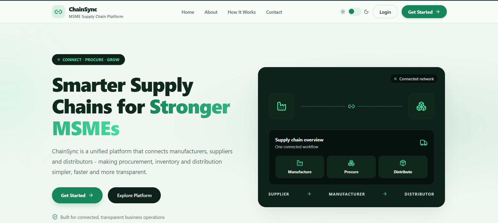
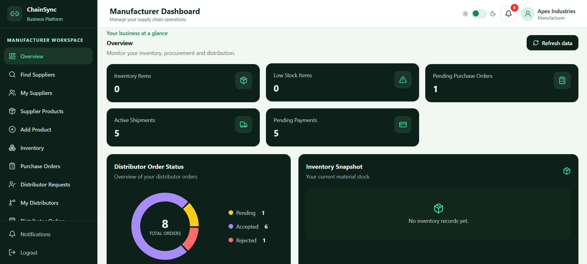
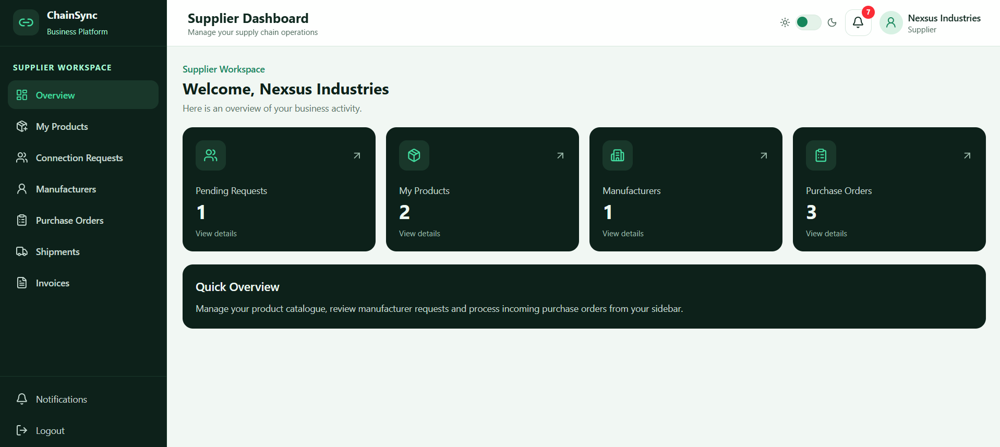
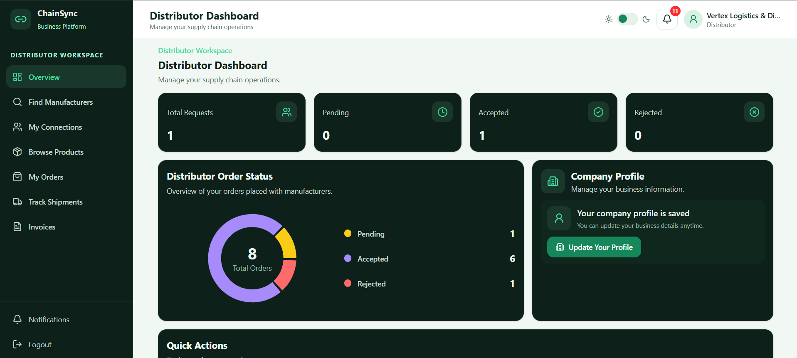
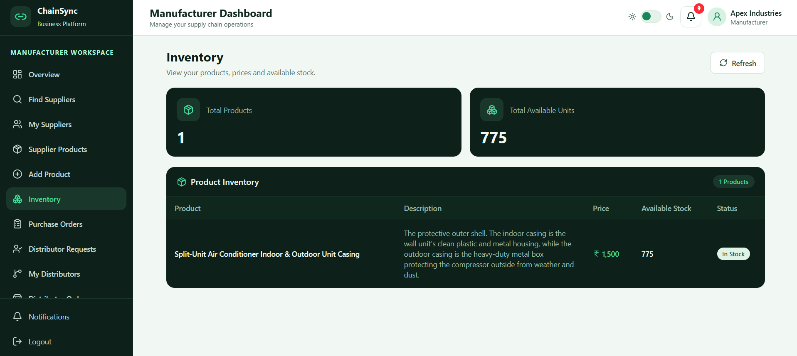
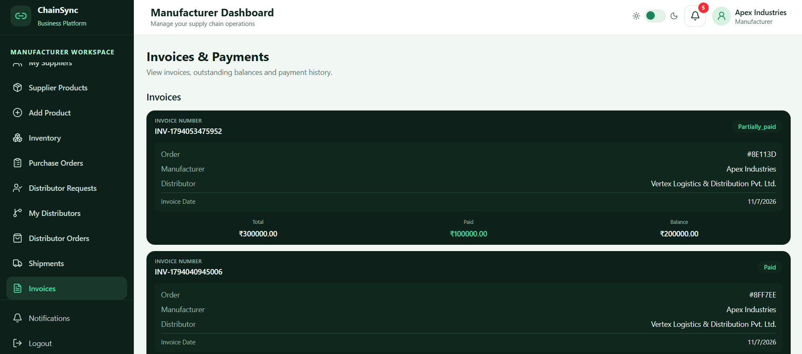

# ChainSync – MSME Procurement & Distribution Platform

ChainSync is a MERN-based B2B platform designed to streamline procurement and distribution operations for Micro, Small, and Medium Enterprises (MSMEs). It connects manufacturers, suppliers, and distributors through role-based workflows, enabling efficient supplier management, purchase orders, order processing, inventory management, shipment tracking, invoicing, and payment tracking.

## 🚀 Key Features

### 1. Role-Based Access

**Manufacturer**
- Manage products and inventory.
- Discover suppliers and send connection requests.
- Manage distributor connections.
- Process distributor orders.
- Handle procurement and invoicing workflows.

**Supplier**
- Create and manage company profiles.
- Manage supplier products.
- Accept or reject manufacturer connection requests.
- Handle purchase orders and supplier-side operations.

**Distributor**
- Connect with manufacturers.
- Browse available products.
- Place and manage orders.
- Track order status and payment information.

### 2. Procurement & Distribution Management

- Supplier discovery and connection management.
- Manufacturer–Supplier and Manufacturer–Distributor relationships.
- Purchase order creation and status management.
- Distributor order processing.
- Product and inventory management.
- Shipment tracking and status updates.
- Invoice generation and status tracking.
- Payment records and payment history.
- Notifications for important platform activities.

### 3. Authentication & Security

- JWT-based user authentication.
- Role-based authorization and protected routes.
- Password hashing for secure credential storage.
- RESTful API architecture.
- MongoDB database integration using Mongoose.

## 🛠️ Tech Stack

| Category | Technologies |
|---|---|
| Frontend | React.js, JavaScript, HTML, CSS |
| Backend | Node.js, Express.js |
| Database | MongoDB, Mongoose |
| Authentication | JWT, bcrypt |
| API Architecture | REST APIs |
| Development Tools | Git, GitHub, Postman, VS Code |

## 📸 Screenshots

### Landing Page




### Manufacturer Dashboard



### Supplier Dashboard



### Distributor Dashboard



### Inventory Management



### Invoices & Payments



## ⚙️ Installation & Setup

### Prerequisites

- Node.js and npm
- MongoDB Atlas account or local MongoDB installation
- Git

### 1. Clone the Repository

```bash
git clone YOUR_GITHUB_REPOSITORY_URL
cd ChainSync
```

### 2. Backend Setup

```bash
cd backend
npm install
```

Create a `.env` file inside the backend directory:

```env
PORT=5000
MONGO_URI=your_mongodb_connection_string
JWT_SECRET=your_jwt_secret
```

Start the backend server:

```bash
npm run dev
```

### 3. Frontend Setup

Open another terminal:

```bash
cd frontend
npm install
npm run dev
```

The frontend will run on the local development URL provided by Vite.

## 📂 Project Structure

```text
ChainSync/
│
├── backend/
│   ├── config/
│   ├── controllers/
│   ├── middleware/
│   ├── models/
│   ├── routes/
│   └── server.js
│
├── frontend/
│   ├── src/
│   │   ├── components/
│   │   ├── pages/
│   │   ├── services/
│   │   ├── context/
│   │   └── App.jsx
│   └── package.json
│
├── screenshots/
│   ├── landing-page.png
│   ├── login.png
│   ├── signup.png
│   ├── manufacturer-dashboard.png
│   ├── supplier-dashboard.png
│   ├── distributor-dashboard.png
│   ├── procurement.png
│   ├── inventory.png
│   ├── shipments.png
│   └── invoices-payments.png
│
└── README.md
```

## 🔄 Application Workflow

1. Users register and log in according to their respective roles.
2. Manufacturers discover suppliers and send connection requests.
3. Suppliers accept or reject incoming requests.
4. Manufacturers manage procurement and purchase orders.
5. Distributors connect with manufacturers and place product orders.
6. Manufacturers process orders and manage inventory.
7. Shipments, invoices, and payments are tracked through their respective workflows.
8. Notifications keep users informed about relevant activities.

## 🎯 Project Objective

The primary objective of ChainSync is to bring manufacturers, suppliers, and distributors onto a unified digital platform. It simplifies business coordination, improves procurement visibility, and helps MSMEs manage their supply chain operations more efficiently.

## 👩‍💻 Developer

**Priyanshi**

GitHub: [priyanshi-official](https://github.com/priyanshi-official)

---
